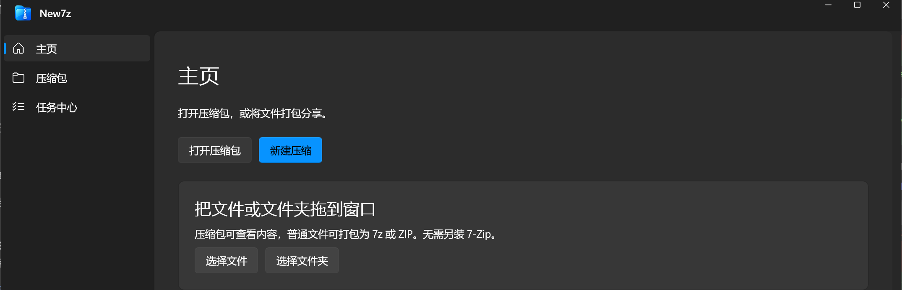
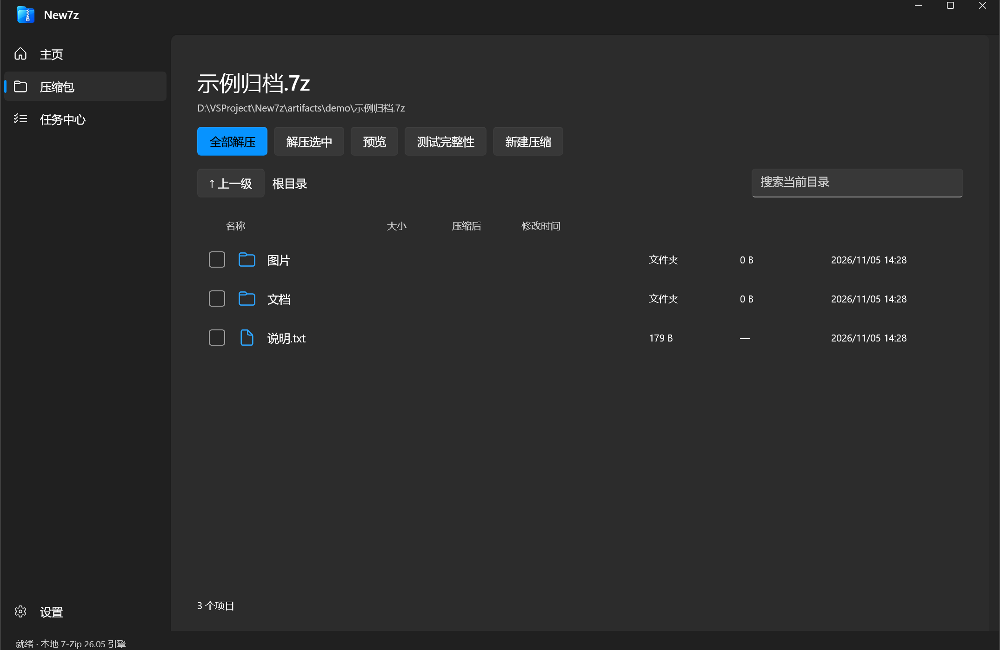
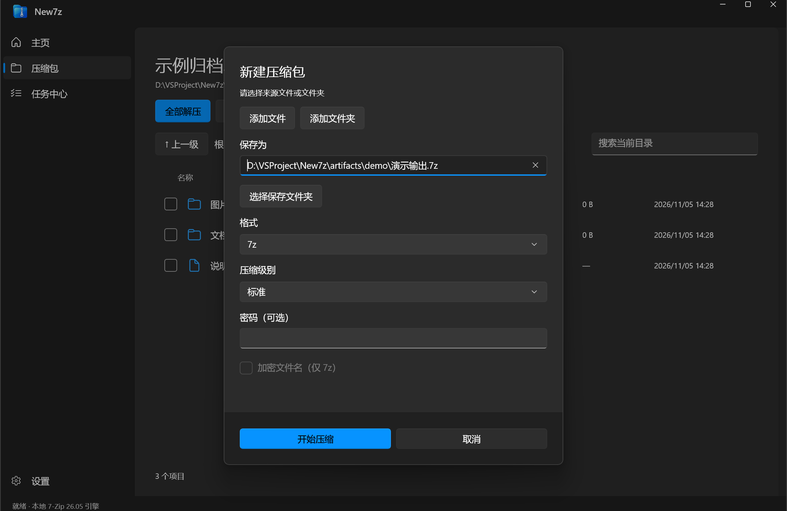
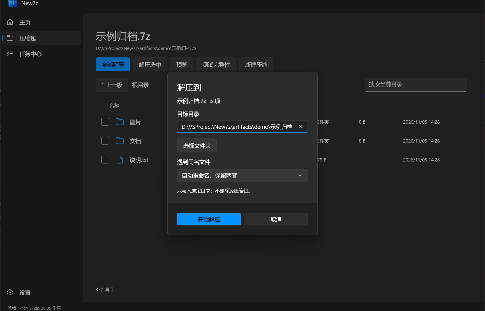
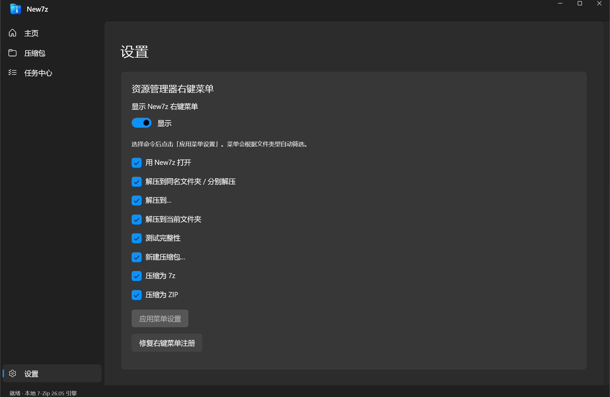

# New7z

Windows 11 Fluent Design 风格的本地压缩工具，基于 WinUI 3 和 7-Zip 引擎。作者：**王国梁**。当前预览版：**0.1.11**，Windows 11 x64。

[下载安装包](https://github.com/outsideoftime/new-7z/releases/latest) · [操作说明](docs/操作说明.md) · [MIT 许可](LICENSE) · [第三方许可](THIRD-PARTY-NOTICES.md) · [安装与分发说明](docs/安装包发布.md)

## 使用

下载安装 EXE，按向导安装到当前用户目录。安装包约 **22.7 MiB**，包含 .NET、WinUI 和自编译 7-Zip 引擎，可离线运行，无需安装完整 7-Zip。当前发行文件尚未进行发布者代码签名。详细操作见 [操作说明](docs/操作说明.md)。

- 创建 7z、ZIP，支持密码与 7z 文件名加密；读取、解压和校验引擎支持的归档。
- 压缩包内直接预览图片和纯文本，支持中文文件名、文件夹、多选解压。
- 资源管理器右键压缩/解压仅打开独立任务小窗口，不显示系统标题栏；成功后可手动或自动关闭，默认手动。
- 设置中配置右键菜单总开关与八项命令，也可修复菜单注册。
- 默认注册到 Windows「默认应用」及 7z、ZIP、RAR、TAR、GZ、XZ、BZ2、ISO 的「打开方式」；设置 → 文件关联 → **选择默认应用**，由用户选择默认格式。
- 应用支持浅色、深色、跟随系统，以及应用内 PNG 图标替换。

勾选菜单任务后，始终提供 **右键 → 显示更多选项 → New7z** 兼容入口；系统具备受信任身份包或现有开发注册条件时，同时注册 Windows 11 现代菜单。不会自动开启开发者模式、导入证书、隐藏 Windows 自带压缩菜单或强制覆盖默认应用。

普通未加密 ZIP 的标准/更快模式使用流式 ZIP 编码；体积优先、密码 ZIP 和全部 7z 使用 7-Zip。读取、预览、解压仍使用 7-Zip。详见 [ZIP 性能记录](docs/ZIP性能优化.md)。

## 界面

| 主页 | 压缩包浏览 |
|---|---|
|  |  |

| 新建压缩 | 解压到 |
|---|---|
|  |  |



更多截图见 [docs/app-screenshots](docs/app-screenshots)。

## 构建

需要 Windows 11 x64、.NET SDK **10.0.403**、Visual Studio C++ x64 工具链和 Windows SDK。使用 PowerShell 7。引擎完整源码归档已包含在仓库，构建脚本自动解压并编译，不需要下载完整 7-Zip 安装程序。

```powershell
# 自包含开发版，输出 artifacts/app
./scripts/build.ps1
# 下载并验证 Inno Setup 6.7.4 编译器，仅用于打包
./scripts/get-build-tools.ps1
# 精简自包含安装包，输出 artifacts/releases
./scripts/build-installer.ps1
```

发行构建采用 WinUI 组件依赖与部分托管裁剪，保留自有程序集和 JSON 源生成上下文；可用 `-Untrimmed` 构建未裁剪对照版。当前两个 Windows SDK/WinRT 第三方程序集会报告 IL2104 裁剪警告，已验证发布版设置、XAML 文件名绑定、文本/图片读取及快捷任务；更多环境仍需验证。

```powershell
./scripts/test.ps1                   # 37 项引擎/安全/配置检查
./scripts/test-shell-preferences.ps1 # 9 项真实 COM 菜单配置检查
./scripts/test-installer.ps1         # 隔离产品标识的安装、修复、关联、升级、卸载检查
# 可通过 -AppDirectory 指定发布目录
./scripts/test-shell.ps1
./scripts/test-popup-close.ps1
```

安装测试临时替换当前用户的 New7z 系统集成，结束后恢复原注册；不覆盖真实产品的卸载标识。不要与实际压缩任务并行运行。GitHub Actions 自动构建安装器并检查引擎与原生菜单。

## 设计和实现范围

[工程说明](docs/工程说明.md) · [功能设计](docs/功能设计.md) · [交互原型](prototype/index.html) · [右键菜单设计](prototype/context-menu-design.html) · [DESIGN.md](DESIGN.md) · [UX-CONTRACT.md](UX-CONTRACT.md)

HTML 原型使用示例数据，不读写真实压缩包；`docs/screenshots` 和 `docs/menu-screenshots` 是原型截图，真实应用截图在 `docs/app-screenshots`。真实产品在 `src/` 与 `native/`。原型检查：`npm ci`、`npm run check`、`npm run verify`、`npm run verify:menus`；浏览器缺失时先执行 `npx playwright install chromium`。

当前为早期预览版：仅 x64，尚无自动更新、跨卷回调、独立引擎崩溃隔离；固实大包的逐文件解压性能、归档列表排序与属性面板仍需完善。RAR 使用完整引擎读取，但尚无 RAR 实例集成测试。具体预览大小限制与差异见工程说明。

自有代码采用 MIT；7-Zip 等组件维持原许可。发行包的 `Licenses` 附第三方通知、7-Zip 完整原始源码和构建适配代码。个人测试源文件、性能压缩包、证书和本地构建缓存不会提交到仓库。
